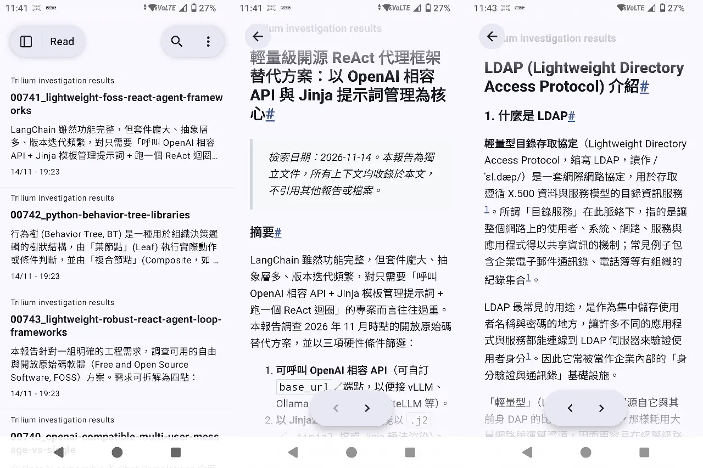
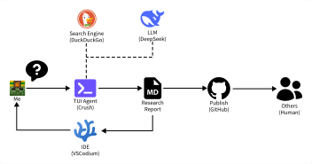
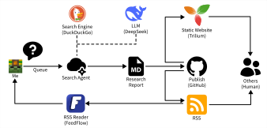

# Dregarnuhr 開發筆記

<head>
  <meta property="og:image" content="https://raw.githubusercontent.com/FlySkyPie/flyskypie.github.io/main/post/2026-11-15_dregarnuhr-devlog/05_tiles.webp" />
</head>

先講結論，使用 [prof18/feed-flow](https://github.com/prof18/feed-flow) 訂閱這個 Fead:

```
https://flyskypie.github.io/investigation-publish-experiment/rss.xml
```

就會得到類似這樣的結果：



然後呢？這是什麼？代表什麼意思？

## Research Skill

上週四 (2026-11-12) 參加 [Hacking Thursday](https://www.hackingthursday.org/) 聚會的時候和人聊了許久，過程中提到了一個我使用了一段時間的 [Skill](https://github.com/agentskills/agentskills)，實際上這不是我第一次提及這件事，我其實已經默默的使用一段時間了，但是並不認為它已經到達可以發表的程度。然而私下分享的幾次得到的反應都不錯，心想或許可以寫一篇文章談談它了。

從今年九月初到現在，它已經作為我日常使用的主要工具之一，不定期會把產物放一個 commit 然後上傳到 GitHub ([FlySkyPie/Mind-Palace](https://github.com/FlySkyPie/Mind-Palace)) 去。

整體而言並沒有什麼技術含量，畢竟 Skill.md 就只是個 Markdown 檔案，大致上來說我做了幾件事：

- 要求 Agent 使用網路搜尋資料，而不是自己憑印象回答。
- 使用的所有描述都必須使用 APA (American Psychological Association) 格式標記引用或參考來源。
- 「自包容」，不能假設讀者具有任何背景知識，任何全新的概念都必須先在文章內解釋。

其他跟研究本身無關約束還有抽號碼牌；確保流水號之類的。

這個流程的誕生甚至可以追朔到今年初的另外一篇文章：

> [自架搜尋引擎套餐 (YaCy + SearXNG + Local Deep Research)](https://flyskypie.github.io/posts/2026-01-12_search-engine/)

當世界因為 Vibe Coding 而瘋狂、喝采與歡呼時，我站在一個極度保守的立場，認為這並不是一個正確的發展方向，畢竟程式碼的產出速度從來不是軟體工程的本質，真正的瓶頸來自於人類大腦的資料處理能力以及人與人之間的溝通成本，如果程式碼產生速度有這麼重要，就不會「人月神話」的存在了。

總之，我認為 LLM 的能力不應該是「產生大量開發者不理解的程式碼」而是用於「降低認知負荷，提高人腦的頻寬」，於是當時我更關注於往這方面發展的 LLM 的工具，然而 Local Deep Research 設計上存在一些一些問題，細節我就不談了，總之它並不能顯著的提高我的工作效率。

直到我發現了 [Crush](https://github.com/charmbracelet/crush)，關於它的網路訪問能力我也已經提過了：

> [Agentic 網路訪問雜記](https://flyskypie.github.io/posts/2026-08-24_agent-search/)

:::info
回去翻文章才發現當時已經有第一代的 "Research Skill" 了，不過因為完全是從 Local Deep Research 照搬的，運作起來並不理想。
:::

總之，仰賴 Crush 的 Harnes 設計；Local Deep Research 啟發的一部分提示詞，這個 Skill 才能誕生。

## What you Feed grows

還記得我的令一篇文章嗎？

> [我想壟斷我自己 (I Want to Monopolize Myself)](https://flyskypie.github.io/posts/2026-08-30_i-want-to-monopolize-myself/)

Facebook 和 Twitter 的資訊流 (Feed) 是我目前依然生活上十分仰賴，但是從供樣商鎖定與去寡頭的角度來看，這並不一個妥當的狀態，然而想要脫離的話，要面對的問題會自然浮現：Feed 的哪裡來？

等等，這個透過 LLM 輔助的研究流程本身就會生成大量的讀物，而我也一直透過 GitHub 讓這些產物變成可公開取得的資料，如果它能夠變成 Feed 的型態呢？一個資料流的圖形浮現在眼前。



一個尚未實現但是較為改進的資料流：



一個調查報告的產製其實是蠻耗時的過程，少則數分鐘，多則二十分鐘都有可能，因此更為理想的形式是非同步的，透過統一的界面提問，等到處理完成自然會觸發 CI/CD 最後推送到 RSS 的閱讀器。

在過去，每一條新聞報導背後都有一個記者，曾幾何時網際網路成為不少新聞的來源，既然 LLM 的盒子已經打開，它創造了「每個人都有自己的專屬記者去蒐集資訊、撰寫報導」的時代。

這條資料流沒有承載「我今天去哪裡玩」或是「我最近吃了什麼」消費物質主義的資訊；
它承載的是「我最近對什麼有興趣」「我最近在學習什麼」的資訊，自包容的特性讓每一篇文章都更容易被旁人所理解。

## Mind Palace become Knowledge Warehouse

[Mind-Palace](https://github.com/FlySkyPie/Mind-Palace) 是我原本用來存放該 Skill 和生成產物的地方，

```
├── .agents
│   └── skills
├── agent-zone
│   ├── 000_README.md
│   ├── 001_apa-format.md
│   ├── researches
│   └── researches.lock
├── CONTRIBUTING.md
└── .human-zone
    ├── idea
    │   ├── 000_mind-palace
    │   ├── 001_stellar-cation-heavy-industries
    │   ├── 002_project-nymphs
    │   ├── 003_project-tiddlyrag
    │   ├── 004_caveman-bottleneck
    │   ├── 005_search-and-web-must-go-first
    │   └── 006_mincraft-of-theseus
    └── README.md
```

從命名和資料結構可以發現，它原本是一個關於「第二大腦」的實驗，目的是讓 LLM 能夠獲得我的想法的上下文，然而大多的調查工作並不需要涉及來自人類（也就是我）那複雜且抽象的概念，最後這個 repo 的功能就漸漸的往純粹的調查歸檔 (Archive) 收斂了。

不過要說它是單純的歸檔似乎也不完全正確，歸檔描述的是一種資料冷儲存的狀態，但是實際上除了高速產生；高速消耗的 Feed 資料的一面以外，這個資料流程有另外一面：

> 「先問起來放」

軟體開發的問題，透過先進行調查，報告本身除了是方便人類閱讀的型態以外，參考路徑能夠快速的定位特定的原始碼檔案或是官方文件段落，因此在調查完後，除了協助人類理解一個命題或是不熟習的軟體以外，報告本身可以餵給 Agentic Coding 的工具用來快速提供上下文以及建立命題約束。

甚至有時候工作面臨問題時，可以利用業餘時間先用這個工具調查一輪，在 Agent 調查的同時，可以跑去追漫畫或動畫，存檔丟到開放空間，上工的時候在直接從開放空間拿調查結果來用。

這種「先問起來放」非同步特性，某種程度的確有一種「第二大腦」的感覺，雖然跟我一開始想像作為思維宮殿運作的方式不太一樣。

在我建立這個 Skill 之前有先在其他情境實驗「LLM 寫報告」的模式，當時給予了兩位數卻在短短的兩天內耗盡，所以這才設定成五位數，在撰寫這篇文章的同時，流水號已經成長到了 753 篇報告。自包容帶來的資訊冗餘是在預期之中的設計，但是如果重複詢問自己已經問過得問題，則不屬於樂見的情況了，很快的我面臨的資料治理的問題。

因此除了將它視為高速產生；高速消費的 Feed 資料以外，還需要將它視作可以被重複使用的資料資產來看待，因此過程中我也考慮使用圖書館分類的機制來對它進行分類，同時 Trilium 本身亦有實做模糊搜尋、HTTP API、MCP...等功能。

有趣的是在調查圖書館分類法時，意外得知的 SKOS (Simple Knowledge Organization System) 和近代才倍受重視的資料治理領域之間居然有一絲關聯，不過這又是另外一個故事了。

## Trilium

[Trilium Notes](https://github.com/TriliumNext/trilium) 是一個開源的筆記軟體，是在我在調查「LLM 協作文件系統」時意外得知的。同時我主要使用的筆記軟體 CodiMD 已經開始觸及設計上限，例如：缺乏全文搜尋、在清單頁面單次 API 取得所有筆記全文的，仰賴前端進行過濾運算，有時候在瀏覽器上表現有卡頓的問題。於是不久前我已經把個人筆記軟體轉移到 Trilium。

即使不使用 Elasticsearch 這樣專門的搜尋資料庫，Trilium 在個人筆記的數量級上依然表現堪用，這啟發了我可以拿它來作為微服務解決某些問題。

## Dregarnuhr

專案代號 Dregarnuhr 涵蓋的範圍就是上述的：

> 利用 LLM 建立一個反寡頭的 Feed 系統。
>

計畫除了上述使用 LLM 建立類似記者或調查員的用法以外，
還包括但不限於：使用 LLM 調校諸如 YaCy 這樣的搜尋引擎現成方案。

核心概念是：像 DeGoogle 這樣的運動早就存在，但是依然有許多實務上不切實際的情況，
然而 LLM 存在給這個命題帶來了一些新的變數，原本需要團隊才能做的事情，現在一個人就能做了，
那為什麼我們不把它用在追求自由上？而是消耗著 Token 做著無關緊要的勞作與玩具，陷入另外一個消費物質主義的陷阱之中？

名稱出自「小書痴的下剋上」輕小說中虛構神祇，為掌管時間、命運與絲線的女神。

## 結論

把 Trilium 作為微服務使用技術上可行，輸出 747 篇報告耗時 1 分 03 秒。

另一方面，這套工作流程也不是一個空談的理想，而是已經部份落地的實際方案，道理上也被私下談過得不少人所信服，那麼是時候擺上檯面談一談了。
